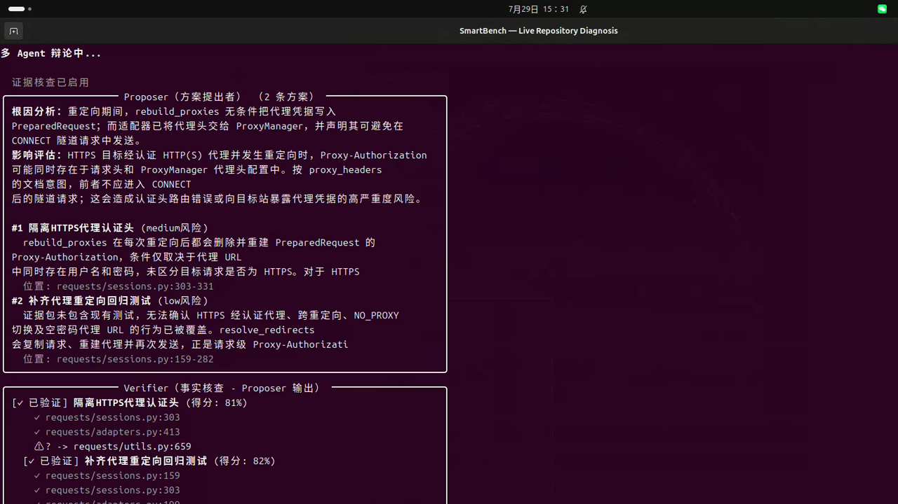

# SmartBench

[](https://github.com/xianyu-sheng/SmartBench/actions/workflows/ci.yml)
[](https://www.python.org/)
[](https://github.com/xianyu-sheng/SmartBench/releases)
[](#project-status)
[](LICENSE)
[](https://github.com/TheJambo/awesome-testing#static-analysis)

[English](README.md) | [中文](README_CN.md)

**Evidence-constrained code diagnosis.** Deterministic analyzers own the source facts; an LLM may only *propose* hypotheses; resolvers and validators decide whether a hypothesis can be bound back to real operations, types and control flow. Anything that cannot be bound stays `unknown` or `abstained` — it is never promoted to a finding.

> The trust boundary is the product: **a model can be wrong, but it cannot turn a wrong claim into a finding.**

## Found in real projects — runtime-verified

| Repository | Finding | Thread | How it was verified |
|---|---|---|---|
| [qi4L/qscan](https://github.com/qi4L/qscan/issues/22) | `CheckSID` leaks a `*sql.DB` on every error path (missing `defer db.Close()`) | **OPEN** | goroutine delta +5 per failed check → 0 after fix |
| [firefart/stunner](https://github.com/firefart/stunner/issues/89) | `testPassword` leaks the TURN connection on every path (brute force accumulates sockets) | **CLOSED** — fix confirmed on `dev`, discovery correct | silent mock server: server-side Read reaches EOF only after the fix |
| [mosajjal/sniproxy](https://github.com/mosajjal/sniproxy/pull/203) | `refresh_interval: 0` panics the process: `time.NewTicker` in the ACL refresh goroutine | **PR OPEN** | reproduced panic at runtime → fix control → tests pass |
| [sparckles/Robyn](https://github.com/sparckles/Robyn/issues/1432) | SSE tests use `stream=True` without closing the response (test hygiene) | **OPEN** | confirmed valid, low severity |
| [emersion/go-imap](https://github.com/emersion/go-imap/pull/773) | `handleAppend` returned a nil error variable, so a malformed APPEND literal produced no tagged response and the client waited forever | **MERGED** | end-to-end TCP test against a mock mailbox session: the client timed out before the fix and received `a2 BAD` after |

Every submission went through the same chain: static audit → runtime reproduction → local fix → control experiment (fails before, passes after). Details in [REAL_WORLD_CASES.md](REAL_WORLD_CASES.md).

The same detection layer reproduces **6/6 known concurrency and resource-lifetime bugs** from Kubernetes, etcd, Prometheus and Requests on controlled before/after snapshots — including the unbounded-goroutine pattern behind [CVE-2026-73500](https://github.com/advisories/GHSA-6vch-q96h-7gc3) (etcd TLS listener DoS).

[中文说明](README_CN.md) · [Live demo](https://xianyu-sheng.github.io/SmartBench/) · [Architecture](docs/ARCHITECTURE.md) · [Usage guide](docs/USAGE_GUIDE.md)

[](https://xianyu-sheng.github.io/SmartBench/)

> [!IMPORTANT]
> SmartBench is a public beta, not a production SAST replacement. It can run controlled repository audits and reproduce a corpus of known defects, but it has **not** established general unknown-bug precision or recall. A clean report means "no supported finding", not "no bugs".
>
> The normal workflow is read-only: SmartBench never edits the analyzed repository, opens an issue or PR, or contacts a maintainer — a human does that separately.

## What it does, and what it does not establish

| Path | Output today | What it does not establish |
|---|---|---|
| Deterministic `unified` analysis | Rule findings, capability assessments, source roles, graph facts, JSON and SARIF | That a clean result means bug-free code |
| `quick` with a configured model | Project hypotheses, evidence-gated review, explicit rejection and abstention states | That a conclusion is proved merely because it cites a real fact |
| Before/after corpus | Reproducible checks that selected analyzers distinguish 25 known fixes | Precision or recall on previously unknown bugs |

The intended user today is someone evaluating the architecture or performing a controlled, human-reviewed repository audit — not a drop-in CI quality gate.

## Bug classes it can find today

This is the current coverage, not a claim of general bug-finding. Deterministic analyzers own the facts; the LLM layer may surface other classes, but only as hypotheses that must bind to a fact ID before they can become a finding.

| Family | What it is built to catch | Evidence basis | Coverage in the corpus |
|---|---|---|---|
| Resource lifecycle | unclosed files, DB connections, HTTP bodies, SQL rows/transactions; missing `defer close`/`cancel` on error paths; cleanup after use instead of before | acquire/cleanup operations, type evidence, CFG dominance (Python/Go semantic; JS/TS partial) | 16/25 cases; real-world qscan #22, stunner #89 |
| Concurrency & lifetime | leaked goroutines, unbounded goroutine spawn, ticker not stopped, mutex/RWMutex not unlocked, WaitGroup misuse, missing context cancel, channel not closed | state machines + interprocedural CFG/ICFG | 4/25 cases; the unbounded-goroutine pattern behind the etcd TLS-listener DoS (CVE-2026-73500) |
| Error handling & correctness | retry without backoff (and patches that make failure handling worse), returned nil error, HTTP error fallthrough, double finalize, proxy-authorization guard | counterfactual retry analysis, control-flow/state checks | 2/25 correctness + 1 configuration-validation; real-world go-imap #773 |
| Security & data flow | SQL injection, command injection, path traversal, hardcoded secrets, insecure randomness | source-to-sink flow rules (Python/TypeScript AST) + evidence gate | built-in rules; not a full taint engine |
| Project-declared state machines | repo-specific lifecycle rules such as "cleanup before response", "flush before return", "guard before use" | YAML-declared states/transitions bound to IR facts | used by the before/after corpus |
| Evidence-gated LLM review | defects outside the built-ins (panic paths, branch-specific leaks, concurrency call sites) | Proposer → Critique → Judge; only fact-bound conclusions survive, everything else stays `unknown`/`abstained` | optional; human review required |

**Not covered (yet):** data races at detector granularity, arbitrary business-logic or spec violations, full interprocedural taint under dynamic dispatch, cross-repository/cross-service consequences, and memory safety for Rust/C++ (those frontends are structural/heuristic). Unknown-bug precision and recall are unmeasured — see [#10](https://github.com/xianyu-sheng/SmartBench/issues/10) and [#11](https://github.com/xianyu-sheng/SmartBench/issues/11).

The 25-case, 50-snapshot before/after corpus (16 resource-lifecycle, 4 concurrency, 2 correctness, 1 configuration-validation, 1 data-integrity, 1 security-state-guard) is what the "50/50" number refers to: every buggy snapshot produces the expected rule, every fixed snapshot produces none.

<details>
<summary>Deterministic rule and analyzer IDs</summary>

- `null_dereference`, `resource_leak`
- `command_injection`, `path_traversal`, `hardcoded_secret`, `sql_injection`, `security_data_flow`, `insecure_random`
- `broad_exception`, `unused_import`, `todo_fixme`
- `retry_without_backoff`
- `project_resource_lifecycle` (project-level analyzer)
- YAML-declared state rules (`DeclarativeStateRule`)

</details>

## Quick start

Python 3.10+ and Git.

```bash
git clone https://github.com/xianyu-sheng/SmartBench.git
cd SmartBench
python -m venv .venv
source .venv/bin/activate            # Windows: .venv\Scripts\activate
python -m pip install -e ".[graph]"
```

**Deterministic analysis (no LLM):**

```bash
smartbench unified run --project /path/to/repo --output report.json --sarif report.sarif

# gate CI on findings (default is exit 0 regardless)
smartbench unified run --project . --fail-on warning

# byte-stable JSON for golden files / diffs
smartbench unified run --project . --output report.json --deterministic-output
```

`--fail-on` accepts `none` (default), `info`, `warning`, `error`. Exit codes: `0` clean at threshold, `1` findings at threshold, `2` bad arguments or internal error.

**Evidence-gated LLM review:**

```bash
export DEEPSEEK_API_KEY="your-key"
smartbench quick --project /path/to/repo \
  --concern "find correctness and resource-lifecycle risks" \
  --output agent-report.json
```

`quick` runs the fused pipeline: `AnalysisSession` → deterministic rules → ProjectReader hypotheses → evidence resolver → Proposer → source verifier → Critique → Judge, with the evidence gate enforced throughout.

**Before submitting a finding upstream — check active branches.** A valid finding on the default branch may already be fixed on `dev`/`develop`/`next`/`release`:

```bash
smartbench check-branches --input agent-report.json --repo /path/to/repo
```

An `Already-fixed` result means **do not submit**. `--json --output file.json` gives the machine-readable form. The checker compares cleanup patterns across branches and runs a commit-history pickaxe (`git log -S`); on shallow clones it fetches only the tip of missing active branches.

**Optional extras:** `python -m pip install -e ".[graph,rag]"` adds the local vector index; without it, deterministic graph retrieval still works.

## How it works

```text
Repository
  -> ScanPlan -> language frontends -> SemanticIR -> SemanticLinker
  -> AnalysisSession
       |-> deterministic rules and declarative state analyzers
       |-> deterministic GraphRAG
       |-> ProjectReader hypothesis
             -> evidence resolver -> validator -> CFG lifecycle analyzer
       `-> EvidencePack { facts, hypotheses, source references }
             -> Proposer -> source verifier -> Critique -> Judge
  -> JSON / SARIF / benchmark report
```

All main entry points share one `AnalysisSession`; repository discovery, language lowering, IR construction and semantic linking run once.

| Command | LLM behavior |
|---|---|
| `smartbench unified run` | None by default; deterministic rules only |
| `smartbench quick` | Optional ProjectReader plus evidence-constrained review |
| `smartbench benchmark run` | None; pinned snapshots and declared expectations |
| `smartbench eval-rag` | None; evaluates retrieval over the session IR |
| `smartbench diagnose` | Local compiler/process/tool probes, not semantic analysis |

The language-neutral analyzers in `smartbench/analysis/` operate over normalized operations and never import a language parser: resource lifecycle (acquire → cleanup with CFG dominance), declarative state machines, control flow / bounded ICFG, intra-procedural taint, and source-backed type evidence.

## Language support

| Language | Level | Boundary |
|---|---|---|
| Python | Semantic, deepest | CFG/ICFG, calls, state rules, surface type evidence from annotations |
| Go | Semantic, deepest | CFG/ICFG, state/resource analysis, surface + `go/types` evidence (`tools/typeprobe`) |
| JavaScript / TypeScript | Semantic, partial | Common statements, calls and control flow; async, exceptions and dynamic dispatch remain partial |
| Rust | Structural | Tree-sitter symbols and graph context; no complete semantic lowering |
| Java, Kotlin, C/C++, Ruby, Swift, C#, Zig | Detection / heuristic | Fingerprinting and fallback structure, not compiler-grade analysis |

The gaps are tracked as claimable issues: [#6](https://github.com/xianyu-sheng/SmartBench/issues/6) (middle tier), [#7](https://github.com/xianyu-sheng/SmartBench/issues/7) (shared lowering scaffolding), [#8](https://github.com/xianyu-sheng/SmartBench/issues/8) (executable conformance suite). New semantic frontends must provide stable locations, explicit capabilities, deterministic IR serialization, and at least one before/after benchmark.

## The evidence boundary

An `EvidencePack` separates two kinds of input:

- `facts` — source-backed graph or analyzer facts with stable `fact-*` IDs;
- `hypotheses` — ProjectReader interpretations and heuristic candidates with `hypothesis-*` IDs.

Hypotheses are visible so later agents can decide what to investigate, but the evidence gate never accepts a hypothesis ID as a fact. A concrete final suggestion must cite valid fact IDs. Missing, ambiguous or conflicting evidence stays `unknown` or `abstained`.

**The current gate validates fact-ID existence, not logical entailment.** A model can cite a real fact that does not support its conclusion. Location verification, deterministic ProjectReader validation and human review are separate requirements; typed conclusion-to-evidence relations remain open work.

ProjectReader never writes to `SemanticIR`. For the implemented resource-lifecycle path it selects a real call and proposes a project-scoped cleanup protocol; the deterministic stages then bind the operation and type evidence, reject zero/multiple structural matches, validate bindings and reachability, run a language-neutral CFG dominance check, and emit either a finding or an explicit abstention. One bounded repair is allowed only after deterministic rejection.

## Reading a report

| Status | Meaning |
|---|---|
| `full` | The relevant frontend meets every declared requirement for that rule |
| `partial` | A documented approximation ran |
| `unsupported` | Required semantics are unavailable — this is not a clean result |
| `unknown` | The rule did not declare enough requirements to claim coverage |
| `abstained` | Evidence was absent, ambiguous, conflicting, or ownership transfer was possible |

Three caveats matter:

- `verified` / `hallucinated` describe source-location and structural-reference checks; they do not prove a bug conclusion is correct;
- `consensus_reached` means Proposer, Critique and Judge all returned schema-valid output — a stage-completion flag, not a statistical agreement score between independent models;
- if Critique or Judge fails, Proposer/Judge output is kept under `unreviewed_suggestions` for audit but not promoted to `final_suggestions`; the console reports an incomplete review rather than a clean result.

## Evaluation: what the numbers mean

**Regression corpus — 50/50.** 25 before/after cases (50 minimal snapshots): public-fix-derived cases (Requests, FastAPI, Prometheus, Kubernetes, Gin, Terraform), SmartBench discoveries (qscan, stunner, sniproxy), a new Python context-manager case, and synthetic pattern fixtures for common defect shapes. Every buggy snapshot produces the expected rule; every fixed snapshot produces none. This shows expressiveness, not unknown-bug recall.

```bash
smartbench benchmark run --manifest benchmarks/real/manifest.yaml --output benchmark-report.json
```

**Negative corpus — 14 clean fixtures.** `benchmarks/negative/` holds ordinary clean code that superficially resembles the bug patterns: context managers, `try/finally`, `defer`, ownership transfer, placeholder secrets, constant commands and guard clauses. CI asserts zero findings at the default confidence threshold (0.7); any finding is a false positive. See [benchmarks/negative/README.md](benchmarks/negative/README.md) for the sampling rules.

```bash
smartbench benchmark run --manifest benchmarks/negative/manifest.yaml --output negative-report.json
```

**Computed metrics — [`benchmarks/metrics.json`](benchmarks/metrics.json).** `smartbench benchmark metrics` regenerates every number below from the manifests (case-level, scoped to each case's target rules; findings outside those rules are ignored):

| Scope | TP | FP | FN | TN | Precision | Recall | F1 | FPR |
|---|---|---|---|---|---|---|---|---|
| overall (positive + negative) | 26 | 0 | 0 | 40 | 1.000 | 1.000 | 1.000 | 0.000 |

By category (same report; `–` means the corpus has no expected findings for that category, so precision/recall are undefined):

| Category | TP | FP | FN | TN | Precision | Recall |
|---|---|---|---|---|---|---|
| resource-lifecycle | 16 | 0 | 0 | 21 | 1.000 | 1.000 |
| concurrency | 5 | 0 | 0 | 5 | 1.000 | 1.000 |
| correctness | 2 | 0 | 0 | 2 | 1.000 | 1.000 |
| configuration-validation | 1 | 0 | 0 | 1 | 1.000 | 1.000 |
| data-integrity | 1 | 0 | 0 | 1 | 1.000 | 1.000 |
| security-state-guard | 1 | 0 | 0 | 1 | 1.000 | 1.000 |
| secrets | 0 | 0 | 0 | 3 | – | – |
| command-injection | 0 | 0 | 0 | 3 | – | – |
| state-guard | 0 | 0 | 0 | 3 | – | – |

Latency on the deterministic path: p50 **114 ms**, p95 **436 ms**, max 763 ms over 64 snapshots. Abstention and provider cost only exist on the LLM path: `quick --trials N` records trial stability, tokens and an indicative cost (unknown models report `n/a` instead of a made-up number). Per-rule, per-language and per-category breakdowns are in the JSON report.

```bash
smartbench benchmark metrics \
  --manifest benchmarks/real/manifest.yaml \
  --negative benchmarks/negative/manifest.yaml \
  --output benchmarks/metrics.json
```

**Trajectory dataset v0 — [`trajectories/v0`](trajectories/v0/).** 69 redacted trajectories (5 real-world outcomes, 50 benchmark snapshots, 14 negative fixtures) under CC-BY-4.0, with a dataset card, manifest and SHA-256; CI validates the schema and hash.

**Real-world sweep — honest numbers.** SmartBench was run over 12 open-source repositories (Python and Go). 410 findings were manually verified, then cross-checked against SDK types and project documentation — and the outcome is worth reading before trusting any number:

- deterministic rules produced **zero** real bugs on these repositories (they are conservative heuristics that don't hallucinate on clean code);
- of 4 findings initially submitted upstream, **3 were wrong** and corrected upstream (an `io.Reader` mistaken for `io.ReadCloser`; two PocketBase claims contradicted by its documented fail-stop design and immediate-nil `Close()`);
- 1 valid observation survived (test hygiene in Robyn);
- the primary failure mode was the verifier's **inability to resolve types across dependency boundaries**.

That last finding drove the type-checker adapter (`tools/typeprobe` + `GoTypeCheckerProvider`). After it: Go repositories emitted 40,650 `TYPE_CHECKER` evidence items resolving 2,453 closer types, and internal verification of LLM suggestions rose from 4/18 (22%) to 13/16 (81%). But an independent cross-check of the two remaining `resty` findings showed **both were still false positives** — internal verification measures *claim grounding*, not real-bug precision. Every candidate still needs cross-dependency review before submission. (This lesson is documented in [docs/TYPE_EVIDENCE_LESSON_CN.md](docs/TYPE_EVIDENCE_LESSON_CN.md).)

## Known limitations

- Most built-in rules are still source heuristics; declarative state rules and the resource-lifecycle analyzer are the strongest semantic examples.
- Exception flow, async scheduling, dynamic dispatch, alias analysis, goroutine happens-before, and interprocedural channel aliases are incomplete.
- The ProjectReader lifecycle analyzer proves normalized defer-style cleanup only.
- The Python frontend lowers direct-call `with` and `async with` resources into explicit acquire, binding, and context-exit registration operations; indirect context-manager expressions remain unknown.
- Large-repository latency and memory use do not have a published budget.
- Local vector/TF-IDF caches are not portable across every optional-dependency change; delete the repository's `.smartbench/` cache if it was created with scikit-learn and is later opened without it.
- Repository content sent through `quick` is visible to the configured remote model provider.
- A clean report can mean "no supported finding", not "the repository has no bugs".

The biggest gaps are open as claimable issues — see the [roadmap](https://github.com/xianyu-sheng/SmartBench/issues/14) and the per-area issues it links (language semantics, measurement, interface).

## Safety

- Source paths are confined to the repository root; external symlinks and `../` escapes are ignored.
- External commands run without a shell, with time and output bounds.
- Optional `quick --sandbox` applies proposed patches only to a temporary copy, but repository tests still run with your OS permissions.
- Do not send repositories containing secrets or restricted code to a remote provider unless that exposure is acceptable.
- Do not file a finding upstream without repeated verification and a human decision.

## Development

```bash
python -m pip install -e ".[dev,graph]"
ruff check smartbench tests
pytest -q
python -m compileall -q smartbench
python -m build
```

CI runs Python 3.10–3.12 tests, parser-adapter checks, the 50-snapshot benchmark, ProjectReader boundary experiments, and a clean-wheel CLI smoke test. Contribution rules (including the required CI-evidence section) are in [CONTRIBUTING.md](CONTRIBUTING.md).

Docs: [Architecture](docs/ARCHITECTURE.md) · [Usage guide](docs/USAGE_GUIDE.md) · [Real-world cases](REAL_WORLD_CASES.md) · [Historic benchmark corpus](benchmarks/real/README.md) · [Blind ProjectReader experiment](benchmarks/experiments/project_reader_blind/README.md)

## Project status

SmartBench is suitable for controlled repository experiments, architecture research, and portfolio demonstrations. It has produced runtime-verified bugs in real projects and ships a 25-case benchmark corpus plus language-neutral analyzers for resource lifecycle, state machines and data flow.

The next useful work is **measurement, not more surface features**:

1. report precision, recall, abstention rate, trial stability, latency and provider cost on the expanded corpus ([#10](https://github.com/xianyu-sheng/SmartBench/issues/10), [#11](https://github.com/xianyu-sheng/SmartBench/issues/11), [#12](https://github.com/xianyu-sheng/SmartBench/issues/12));
2. deepen language semantics (exception flow, async, aliasing, concurrency) without weakening the IR boundary;
3. make language onboarding cheap ([#6](https://github.com/xianyu-sheng/SmartBench/issues/6)–[#8](https://github.com/xianyu-sheng/SmartBench/issues/8)) and expose a public API ([#9](https://github.com/xianyu-sheng/SmartBench/issues/9)).

Every corpus number is regenerable with `smartbench benchmark metrics`; the committed sample is [benchmarks/metrics.json](benchmarks/metrics.json).

## Roadmap: from findings to verifiable audit trajectories

Finding bugs is not the end product. The goal is a **verifiable audit trajectory engine**: findings are a by-product; the trajectory (hypothesis → evidence → verdict) and its adjudication are the reusable, trainable, auditable asset. Every step below is independently useful and makes the next one cheaper.

- [x] **Document the bug classes** the deterministic layer can find today (see above) and file the four post-audit directions as claimable issues ([#45](https://github.com/xianyu-sheng/SmartBench/issues/45)–[#48](https://github.com/xianyu-sheng/SmartBench/issues/48)).
- [x] **Measurement** — negative corpus ([#11](https://github.com/xianyu-sheng/SmartBench/issues/11)), honest precision / recall / abstention / cost numbers ([#10](https://github.com/xianyu-sheng/SmartBench/issues/10), [#12](https://github.com/xianyu-sheng/SmartBench/issues/12)), and the evaluation matrix below.
- [x] **Trajectory schema** — every `quick`/`unified` run can be recorded as `smartbench.trajectory/v1`, with redaction, local storage, export and deterministic replay ([#46](https://github.com/xianyu-sheng/SmartBench/issues/46)). This is the starting point of the data asset.
- [x] **Feedback events** — human confirm/reject recorded as `smartbench.feedback/v1`; offline ranking and advisory thresholds (no training, no suppression) ([#45](https://github.com/xianyu-sheng/SmartBench/issues/45), phase 1).
- [x] **Publish Audit Trajectories v0** — 5 disclosed real cases + the 25-case corpus + 14 negative fixtures in [`trajectories/v0`](trajectories/v0/), with a dataset card, CC-BY-4.0 license, redaction and takedown policy.
- [ ] **Container sandbox** — a rootless container backend for dynamic verification ([#47](https://github.com/xianyu-sheng/SmartBench/issues/47)); small, low-risk, raises the trust level of "verified".
- [ ] **Sharded review** — deterministic shard plan + bounded parallel sub-agents + lead merge, default off until it matches sequential results ([#48](https://github.com/xianyu-sheng/SmartBench/issues/48)).
- [ ] **Policy learning** — only after trajectories and an evaluation set exist; otherwise it is unfalsifiable optimization.

**Why this order.** Measurement and trajectories are the shared foundation for the sandbox, sharding and learning work. Parallelism without a merge/evidence story only adds noise; policy learning without an evaluation set cannot prove it got better.

Honest competitive note: context engineering, sub-agents, sandboxes and trajectory datasets already exist separately (Cursor/Sourcegraph/Aider; Claude Code/Devin; Firecracker/E2B; SWE-Gym/SWE-smith/R2E). What is still missing is an **evidence-constrained audit loop** — hypothesis → bound evidence → adjudication → outcome. That is the gap this roadmap targets.

## Recognition

- [Awesome Testing](https://github.com/TheJambo/awesome-testing#static-analysis) — listed under **Static Analysis** ([PR #305](https://github.com/TheJambo/awesome-testing/pull/305), merged 2026-10-19).

## License

[MIT](LICENSE)
